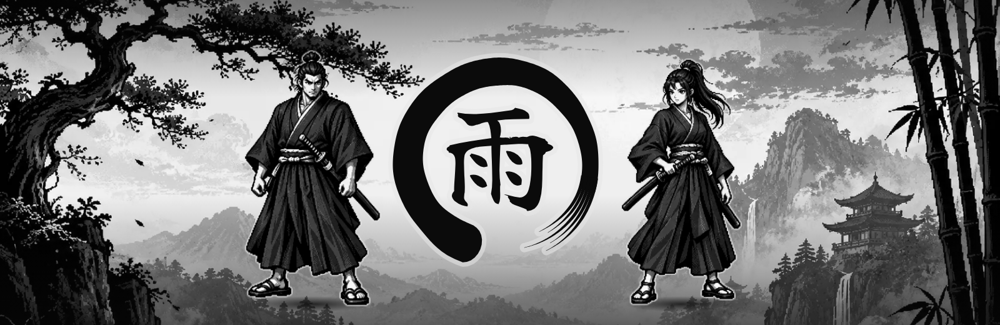
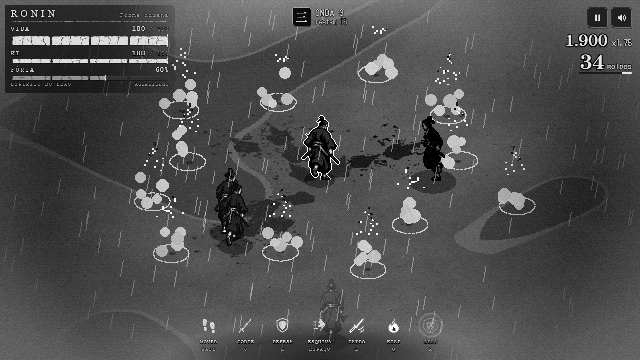
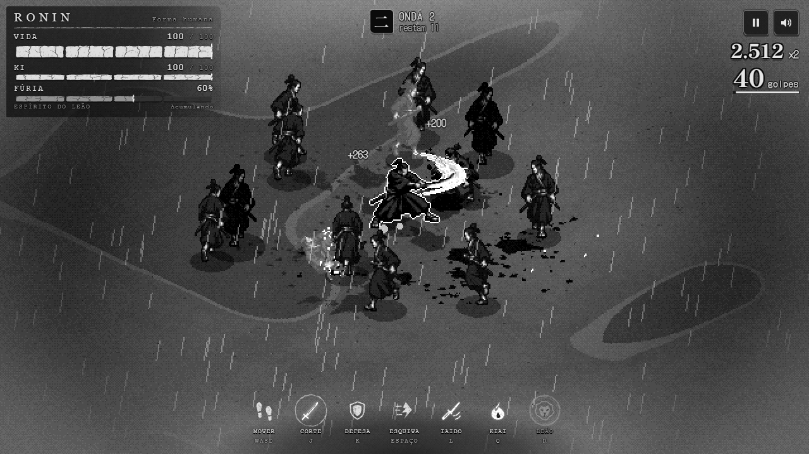
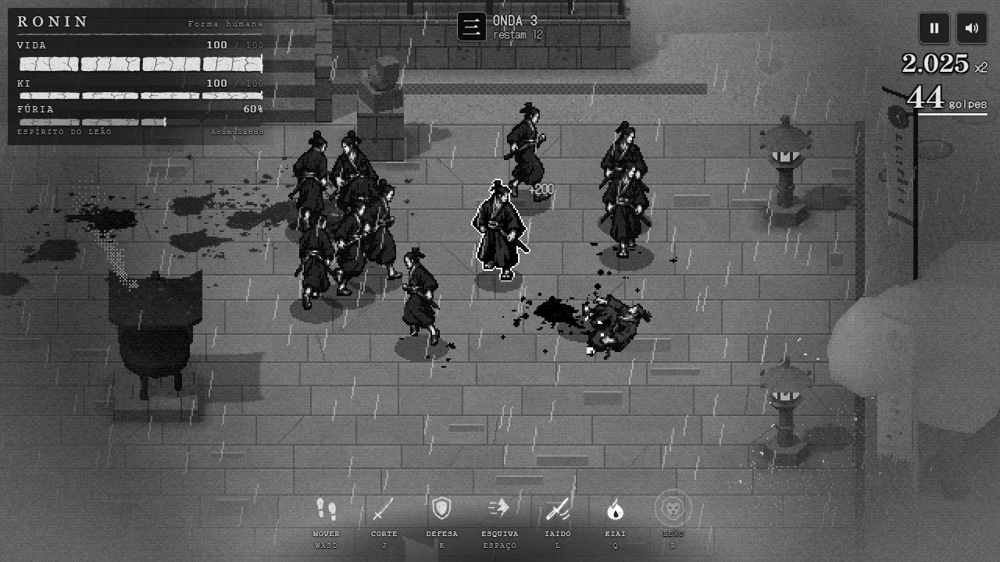
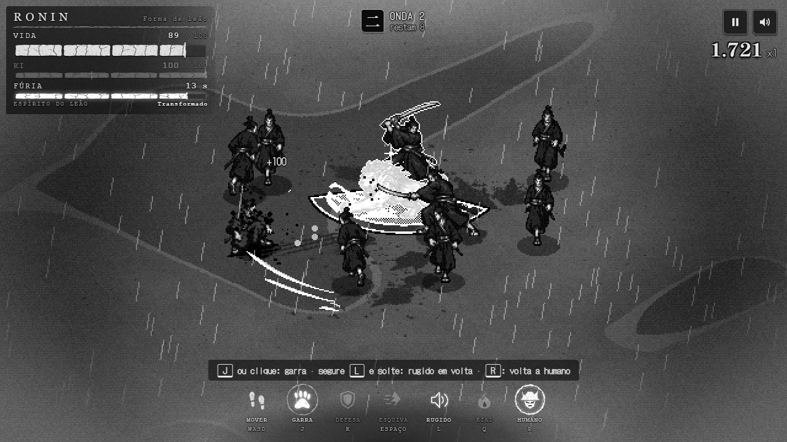
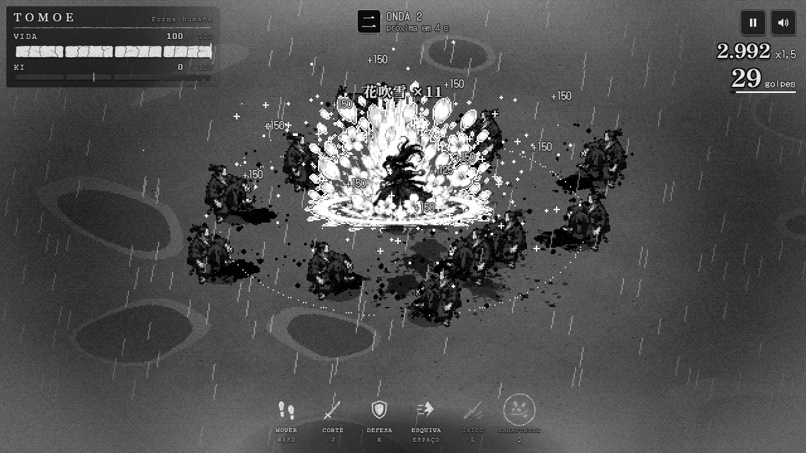

<p align="center">
  
</p>

<p align="center">
  <b>One samurai against the horde, in rain and mud.</b><br>
  A monochrome isometric pixel art action game for your browser.
</p>

<p align="center">
  <a href="https://userjesus.github.io/ronin-game/">Play</a> ·
  <a href="#run-locally">Run locally</a> ·
  <a href="docs/arquitetura.md">Architecture (PT-BR)</a> ·
  <a href="docs/processo.md">Development process (PT-BR)</a> ·
  <a href="README.md">Português</a>
</p>

The Play URL becomes available after the first GitHub Pages deployment. See the [publishing guide](docs/publicacao.md).

## A symbol, without a title

The game has no written name. Its identity is an ink **ensō** surrounding **雨**, the kanji for rain.
The symbol is drawn by [`src/ui/title/art.ts`](src/ui/title/art.ts), which also supplies the repository's
branding. `ronin-game` is the technical package and repository identifier; Ronin is a playable character.

## The game

Choose Ronin or Tomoe and survive growing waves of enemies. Fight across a muddy battlefield or a temple
courtyard, with rain, fog, torn banners and a stone-and-ink HUD. The stage is selected for each new run.

<p align="center"></p>

| Ronin 侍 | Tomoe 巴 |
|---|---|
| Kiai: an area spirit burst at full Ki | Hanafubuki: a storm of petals at full Ki |
| Lion form at full Fury: claw attacks and an area roar | Human combat with her own animations and effects |

Both characters share a three-hit combo, guard, timed parry, dodge and charged iaido. Enemy types have
different movement and attack patterns. The game supports keyboard and mouse, gamepad and touch.

<table>
  <tr>
    <td></td>
    <td></td>
  </tr>
  <tr>
    <td></td>
    <td></td>
  </tr>
</table>

## Run locally

Install **Node.js 22.12 or newer** (Node 24 is selected in [`.nvmrc`](.nvmrc)) and use a browser with WebGL2.
No backend, API keys, database or environment file is required.

```bash
git clone https://github.com/userJesus/ronin-game.git
cd ronin-game
npm ci
npm run dev
```

Open **http://localhost:5173**. If PowerShell blocks `npm.ps1`, use `npm.cmd` / `npx.cmd` or Command Prompt.
If the port is occupied, stop the existing server or use `npm run dev -- --port 5174`.

```bash
npm run build          # typecheck and production output in dist/
npm run preview        # http://localhost:4173
npm run build:single   # dist-single/index.html, playable from disk
```

The single-file build embeds game code and artwork. UI fonts load from Google Fonts; offline, the game
uses fallback fonts. Include the project license and [third-party notices](THIRD_PARTY_NOTICES.md) when
redistributing the build. Audio starts after user interaction. WebGL2 initialization failures may require
enabling browser graphics acceleration.

## Controls

| Action | Keyboard / mouse | Gamepad |
|---|---|---|
| Move | WASD / arrows | Left stick / D-pad |
| Aim | Mouse cursor | Right stick |
| Attack / lion claw | J / left mouse | X / RB |
| Hold guard / timed parry | K or I / right mouse | RT |
| Dodge | Space / Shift | A / LB |
| Charge and release iaido / lion roar | L / E | B / LT |
| Special at full Ki | Q | Y |
| Transform at full Fury / return to human | R | R3 |
| Pause | Esc / P | Start |
| Mute | M | Select |

Touch devices display a virtual joystick and action buttons. The game interface is currently in Brazilian Portuguese.

| URL parameter | Effect |
|---|---|
| `?seed=7` | Fixed seed; the same simulation inputs reproduce the same result |
| `?stage=field` / `?stage=temple` | Force a stage |
| `?char=tomoe` | Preselect Tomoe |
| `?autostart` | Start immediately |

## Technology and development

| Technology | Role |
|---|---|
| three.js r186 | WebGL2 rendering, orthographic camera, instanced sprites, shadows and post-processing |
| TypeScript 7 | Strictly typed simulation and presentation |
| Vite 8 / vite-plugin-singlefile | Development server and normal / single-file builds |
| Web Audio API | Procedural effects, rain and music, without audio files |
| Vitest 5 | 182 unit tests, including deterministic simulation and an automated balance player |
| Playwright 1.63 / pngjs | 20 browser tests, image processing and reproducible documentation captures |

The simulation runs at a fixed 1/60 s timestep without the DOM or three.js. It emits events consumed by
rendering, effects, audio and UI. A low-resolution buffer, nearest-neighbor scaling and monochrome
post-processing give the 3D environments and sprite characters a common visual language.

The initial development took place on September 30 and October 1, 2026, directed by the author using
Claude Code. The inherited development notes describe separate module ownership, parallel implementation,
independent review and visual checks. Character and menu artwork was generated with ChatGPT (gpt-image),
then processed into atlases by the project's scripts. Codex completed the public repository preparation,
media pipeline, documentation and validation. See [the detailed process](docs/processo.md) for historical
sources, reconstruction limits and design decisions.

```text
src/sim/       deterministic game rules
src/render/    camera, sprites, poses and renderer
src/world/     procedural stages, rain and lightning
src/fx/        combat effects and particles
src/audio/     procedural sound
src/ui/        title, HUD and touch controls
src/input/     keyboard, mouse, gamepad and touch input
src/assets/    generated sprite atlas and menu images
assets-src/    original artwork sheets
scripts/       asset processing, branding, captures and repository audit
tests/         unit and browser tests
docs/          architecture, process, art direction and media
```

## Validate and contribute

```bash
npx playwright install chromium
npm run check
```

This checks repository links and publishable files, TypeScript, unit tests, both builds and browser tests.
Individual commands: `npm run check:repo`, `npm run typecheck`, `npm test`, `npm run test:e2e`.
On Linux CI, install browser system dependencies with `npx playwright install --with-deps chromium`.

`npm run sprites` and `npm run menu-art` regenerate artwork. `npm run brand` generates the emblem,
icons and banners. With the game running, `npm run media` captures the README images and verifies the GIF.

Read [CONTRIBUTING.md](CONTRIBUTING.md), the [Code of Conduct](CODE_OF_CONDUCT.md),
[visual identity guide](docs/identidade.md) and [security policy](SECURITY.md).
Code and original project artwork: [MIT](LICENSE), © 2026 Jesus C. Oliveira.
Third-party credits and license copies: [THIRD_PARTY_NOTICES.md](THIRD_PARTY_NOTICES.md).
