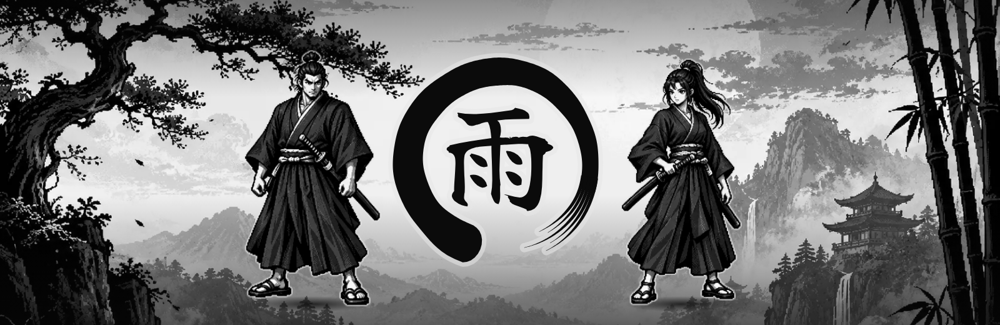
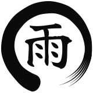
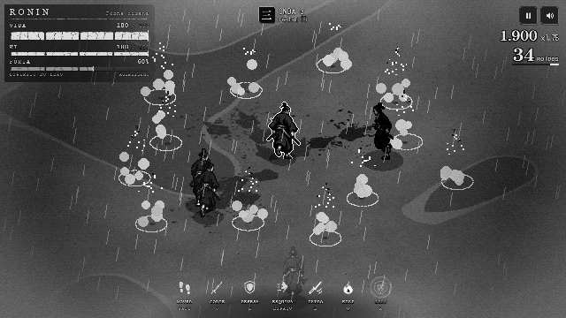
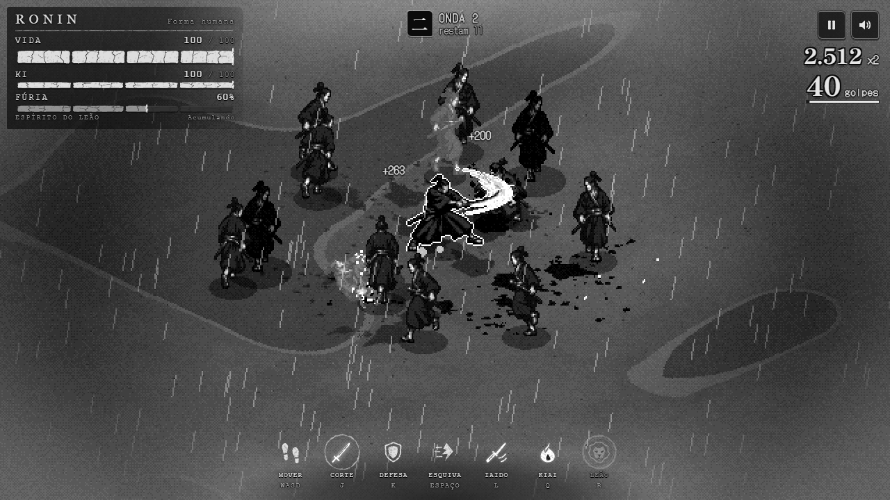
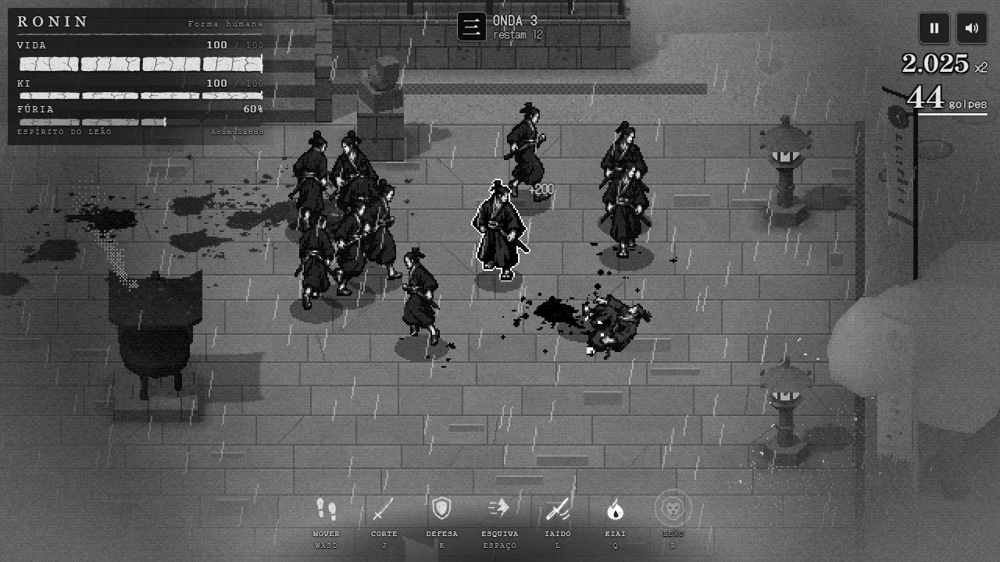
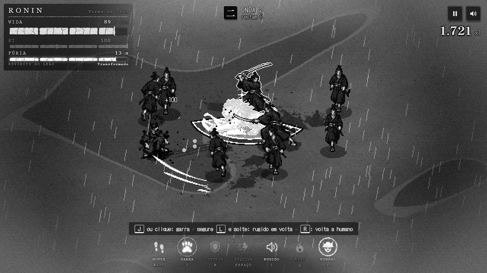
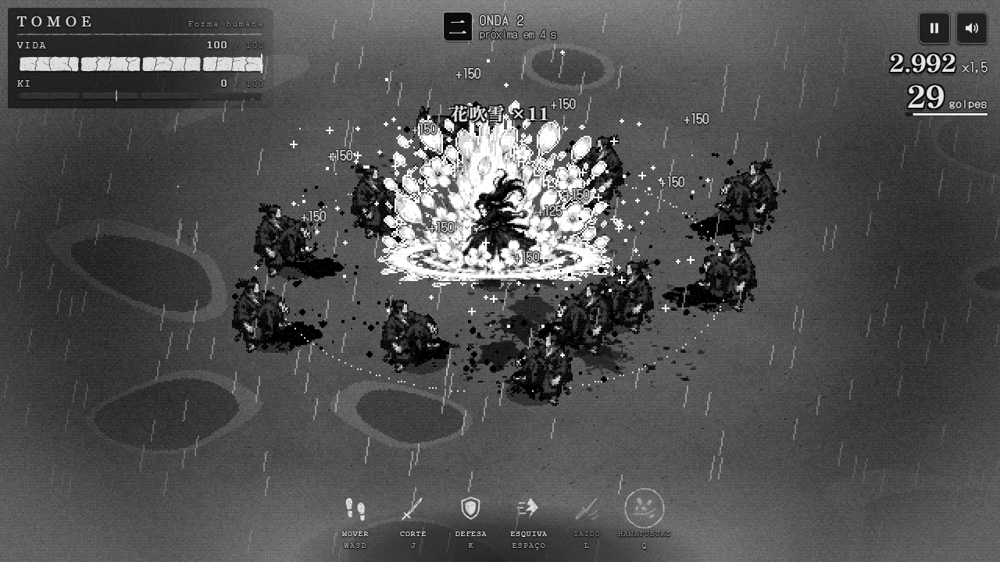
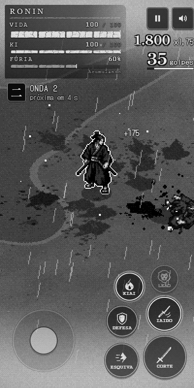
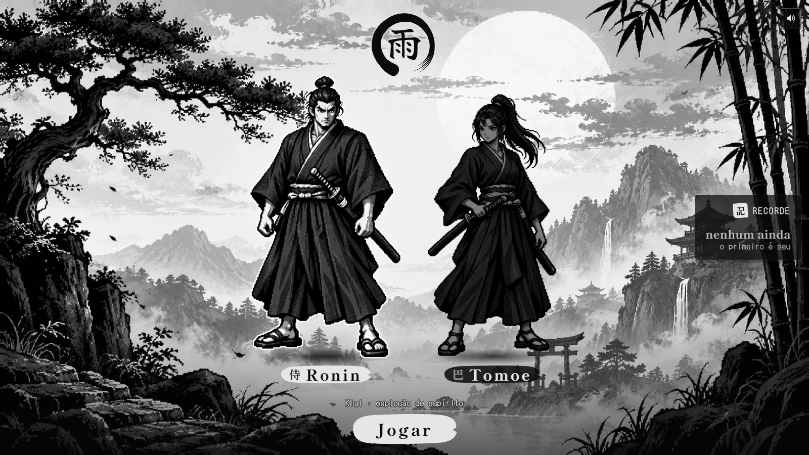

<p align="center">
  
</p>

<p align="center">
  <b>Um samurai sozinho contra a horda, na chuva e na lama.</b><br>
  Ação isométrica em preto e branco e pixel art, direto no navegador.
</p>

<p align="center">
  <a href="https://userjesus.github.io/ronin-game/"></a>
  <a href="https://github.com/userJesus/ronin-game/actions/workflows/ci.yml"></a>
  <a href="LICENSE"></a>
  
  
  
</p>

<p align="center">
  <a href="https://userjesus.github.io/ronin-game/">Jogar</a> ·
  <a href="#rodando-localmente">Rodar localmente</a> ·
  <a href="docs/arquitetura.md">Arquitetura</a> ·
  <a href="docs/processo.md">Como foi feito</a> ·
  <a href="docs/identidade.md">Identidade visual</a> ·
  <a href="README.en.md">English</a>
</p>

---

O endereço **Jogar** fica disponível depois do primeiro deploy no GitHub Pages. Para publicar sua cópia,
veja [o guia de publicação](docs/publicacao.md).

<picture>
  <source media="(prefers-color-scheme: dark)" srcset="docs/media/emblem-paper.svg">
  
</picture>

## O símbolo

O jogo não tem nome. Tem só um símbolo: um **ensō**, o círculo zen pintado num único gesto de pincel, com o kanji **雨** (*ame*, chuva) no meio. Não é um arquivo de imagem: o símbolo é desenhado por código ([`src/ui/title/art.ts`](src/ui/title/art.ts)), sempre igual, e o mesmo código gera o favicon e as imagens deste repositório.

## O jogo

Um campo de batalha de Kurosawa: lama, neblina, bandeiras rasgadas e uma chuva que não para. Você escolhe um dos dois samurais e enfrenta ondas cada vez maiores de inimigos, numa câmera isométrica em pixel art e só em tons de cinza.

<p align="center">
  
</p>

<table>
  <tr>
    <td width="50%"></td>
    <td width="50%"></td>
  </tr>
  <tr>
    <td align="center"><b>野 Campo de batalha</b>: lama e poças, nada onde se esconder</td>
    <td align="center"><b>寺 Templo</b>: salão, pagode, torii e cedros que viram obstáculos</td>
  </tr>
  <tr>
    <td width="50%"></td>
    <td width="50%"></td>
  </tr>
  <tr>
    <td align="center"><b>獅 Forma de leão</b>: Garra 爪 e Rugido 吼</td>
    <td align="center"><b>花吹雪 Hanafubuki</b>: a tempestade de pétalas da Tomoe</td>
  </tr>
</table>

### Personagens

| | Ronin 侍 | Tomoe 巴 |
|---|---|---|
| Golpe especial | **Kiai 気合**: explosão de espírito em volta | **Hanafubuki 花吹雪**: tempestade de pétalas |
| Habilidade própria | **Forma de leão 獅**: com a Fúria cheia, vira leão por 14 s, com Garra de 5 m de alcance e Rugido em área | — |

Os dois têm o mesmo repertório básico: combo de três cortes, defesa e parry (defender no instante do golpe atordoa o inimigo), esquiva e **iaido**, um saque carregado que custa 40 de Ki. A horda mistura três tipos de inimigo (ronin, brutamontes e ágil), contorna obstáculos e ataca em turnos. A cada partida o cenário é sorteado.

### Controles

| Ação | Teclado | Mouse | Gamepad | Toque |
|---|---|---|---|---|
| Mover | WASD / setas | — | analógico esquerdo / direcional | joystick virtual |
| Mirar | — | cursor | analógico direito | — |
| Corte (combo de 3) · como leão, Garra | J | botão esquerdo | X / RB | botão Corte |
| Defesa (segurar) · parry (no instante do golpe) | K / I | botão direito | RT | botão Defesa |
| Esquiva | Espaço / Shift | — | A / LB | botão Esquiva |
| Iaido (segurar e soltar) · como leão, Rugido | L / E | — | B / LT | botão Iaido |
| Kiai / Hanafubuki (Ki cheio) | Q | — | Y | botão especial |
| Leão (Fúria cheia; de novo, volta a humano) | R | — | R3 | botão Leão |
| Pausa | Esc / P | — | Start | botão de pausa |
| Som | M | — | Select | botão de som |

No celular, o jogo mostra os controles de toque sozinho.

<details>
  <summary>Ver os controles no celular</summary>
  <p align="center"></p>
</details>

<p align="center">
  
</p>

## Rodando localmente

**Requisitos:** [Node.js](https://nodejs.org/) 22.12 ou mais novo (recomendado: 24 LTS, ver [`.nvmrc`](.nvmrc)) e um navegador com WebGL2 (Chrome, Edge, Firefox ou Safari atuais).

```bash
git clone https://github.com/userJesus/ronin-game.git
cd ronin-game
npm ci
npm run dev
```

Abra **http://localhost:5173**. O Vite recarrega a página a cada alteração no código.

No Windows, se o PowerShell bloquear `npm.ps1`, use `npm.cmd` e `npx.cmd` nos mesmos comandos,
ou execute-os no Prompt de Comando. Não é necessário mudar a política de execução do sistema.
O projeto é estático: não precisa de `.env`, chave de API, banco de dados ou serviço de backend.

Para gerar e servir o build de produção:

```bash
npm run build      # checa os tipos e gera dist/
npm run preview    # serve dist/ em http://localhost:4173
```

`npm run build:single` gera `dist-single/index.html`, um arquivo único com todo o código e a arte do jogo embutidos, que abre direto do disco, sem servidor. As fontes vêm do Google Fonts; sem internet, o navegador usa fontes de reserva. Para redistribuir, inclua também os [avisos de terceiros](THIRD_PARTY_NOTICES.md) e as licenças.

Se o navegador não conseguir criar o WebGL2, habilite a aceleração gráfica ou experimente outro navegador
compatível. O som começa após a primeira interação. Se a porta 5173 estiver ocupada, encerre o servidor
anterior ou rode `npm run dev -- --port 5174` e abra o endereço informado no terminal.

### Parâmetros de URL

| Parâmetro | Efeito |
|---|---|
| `?seed=7` | fixa a semente; com as mesmas entradas, a simulação se repete |
| `?stage=field` ou `?stage=temple` | fixa o cenário em todas as partidas |
| `?char=tomoe` | abre o título com a Tomoe escolhida |
| `?autostart` | pula o título e começa a partida |

### Comandos

| Comando | O que faz |
|---|---|
| `npm run dev` | servidor de desenvolvimento em http://localhost:5173 |
| `npm run build` | checa os tipos e gera o build em `dist/` |
| `npm run preview` | serve o build em http://localhost:4173 |
| `npm run build:single` | gera o jogo num arquivo só, em `dist-single/index.html` |
| `npm run typecheck` | checagem de tipos (TypeScript, sem emitir arquivos) |
| `npm test` | testes de unidade (Vitest) |
| `npm run test:e2e` | testes de ponta a ponta (Playwright); na primeira vez, rode `npx playwright install chromium` |
| `npm run check:repo` | confere links locais, identidade, lockfile e arquivos destinados ao Git |
| `npm run check` | auditoria do repositório, tipos, unidade, os dois builds e ponta a ponta |
| `npm run sprites` | regera o atlas dos personagens a partir das folhas em `assets-src/` |
| `npm run menu-art` | regera a arte do título a partir de `assets-src/` |
| `npm run brand` | regera o símbolo, o favicon e as imagens de compartilhamento |
| `npm run media` | regera as capturas deste README, com o jogo rodando |

## Tecnologias

| | Para quê |
|---|---|
| [three.js](https://threejs.org/) r186 | renderização WebGL2: câmera ortográfica isométrica, sprites instanciados, sombras e pós-processamento |
| [TypeScript](https://www.typescriptlang.org/) 7 | todo o código, em modo estrito |
| [Vite](https://vite.dev/) 8 | servidor de desenvolvimento e build (e [vite-plugin-singlefile](https://github.com/richardtallent/vite-plugin-singlefile) para o arquivo único) |
| Web Audio API | todo o som do jogo, sintetizado em tempo real, sem nenhum arquivo de áudio |
| [Vitest](https://vitest.dev/) 5 | testes de unidade da simulação |
| [Playwright](https://playwright.dev/) 1.63 | testes de ponta a ponta e scripts de captura de tela |
| [pngjs](https://github.com/pngjs/pngjs) | leitura e escrita de PNG nos scripts de arte |
| [Google Fonts](https://fonts.google.com/) | DotGothic16 (interface pixelada) e Shippori Mincho B1 (títulos) |

Algumas decisões técnicas:

- **Simulação determinística e separada da renderização.** [`src/sim/`](src/sim/) não conhece three.js nem o DOM: roda em passo fixo de 1/60 s, com sorteios por um gerador semeado. A mesma semente e as mesmas entradas repetem a simulação; os 182 testes de unidade rodam no Node, em poucos segundos.
- **Pixel art de verdade.** A cena é desenhada num buffer de baixa resolução (1 px = 1/32 m, cerca de 480 linhas) e ampliada por um fator inteiro, sem suavização. O pós-processamento converte tudo para tons de cinza e aplica uma neblina radial a partir da profundidade.
- **Eventos como contrato.** A simulação emite eventos (`SimEvent`) que alimentam efeitos, áudio e interface, sem que esses módulos mexam no estado do jogo.

Os detalhes, com diagramas, estão em [docs/arquitetura.md](docs/arquitetura.md).

## Como foi feito

O jogo foi construído em cerca de dois dias, em 30 de setembro e 1º de outubro de 2026, pelo autor dirigindo o [Claude Code](https://www.anthropic.com/claude-code) (Anthropic) em workflows multiagente:

1. **Briefing como fonte da verdade.** [docs/brief.md](docs/brief.md) define a direção de arte, a técnica e os contratos entre módulos.
2. **Núcleo primeiro.** Simulação determinística, renderização e laço do jogo.
3. **Módulos em paralelo.** Cenário, efeitos, áudio, interface e testes foram construídos ao mesmo tempo, cada agente com os seus próprios arquivos e um contrato fixo.
4. **Revisão adversarial.** Cada entrega passou por revisores independentes, que procuravam problemas concretos. Cada achado era confirmado ou refutado antes de qualquer correção, com capturas de tela do jogo rodando.
5. **Testes.** Unidade, um robô de balanceamento que joga sozinho e testes de ponta a ponta no navegador.

A arte dos personagens, do leão e do menu foi gerada com o **ChatGPT (gpt-image)** como folhas de animação em fundo verde. Os scripts em [`scripts/`](scripts/) recortam os quadros, normalizam a escala e montam o atlas de pixel art. Os PNGs originais em [`assets-src/`](assets-src/) guardam os metadados C2PA de procedência. O som é todo sintetizado em código.

A história completa, com a linha do tempo, está em [docs/processo.md](docs/processo.md).

A preparação pública iniciada com Claude Code foi concluída com Codex: mídias reproduzíveis, documentação
em inglês, créditos, revisão dos workflows e validação de instalação, testes e builds.

## Estrutura do projeto

```text
src/
├── sim/        simulação determinística: jogador, horda, ondas, pontuação
├── render/     câmera, renderizador de baixa resolução, sprites e poses
├── world/      cenários (campo e templo), chuva e relâmpagos
├── fx/         efeitos: arcos dos golpes, partículas, marcas no chão
├── audio/      áudio procedural (Web Audio)
├── ui/         HUD, HUD de pedra e tinta, tela de título e controles de toque
├── input/      teclado, mouse, gamepad e toque
├── core/       matemática e gerador pseudoaleatório
└── assets/     atlas dos personagens e arte do título (gerados pelos scripts)
assets-src/     folhas de arte originais
scripts/        extração de sprites, arte do título, marca e capturas
tests/          unidade (Vitest) e ponta a ponta (Playwright)
public/         favicon e imagem de compartilhamento
docs/           briefing, arquitetura, processo e imagens deste README
```

## Contribuindo

Correções, ideias e melhorias são bem-vindas. Leia o [guia de contribuição](CONTRIBUTING.md) e o [Código de Conduta](CODE_OF_CONDUCT.md). Para relatar uma falha de segurança, veja [SECURITY.md](SECURITY.md).

## Créditos e licença

- **Código e arte:** [licença MIT](LICENSE), © 2026 Jesus C. Oliveira ([@userJesus](https://github.com/userJesus)).
- **Arte:** gerada com IA (ChatGPT, gpt-image) sob direção do autor e processada pelos scripts do projeto.
- **Fontes:** [DotGothic16](https://fonts.google.com/specimen/DotGothic16) e [Shippori Mincho B1](https://fonts.google.com/specimen/Shippori+Mincho+B1), via Google Fonts (SIL Open Font License 1.1). O contorno do 雨 do símbolo vem da fonte [Yuji Boku](https://fonts.google.com/specimen/Yuji+Boku) (SIL Open Font License 1.1).
- **Bibliotecas:** [three.js](https://github.com/mrdoob/three.js) (MIT) e as ferramentas listadas em [`package.json`](package.json).

Consulte [THIRD_PARTY_NOTICES.md](THIRD_PARTY_NOTICES.md) para os avisos e as cópias locais de licenças.

<p align="center">
  <br>
  <picture>
    <source media="(prefers-color-scheme: dark)" srcset="docs/media/emblem-paper.svg">
    
  </picture>
</p>
