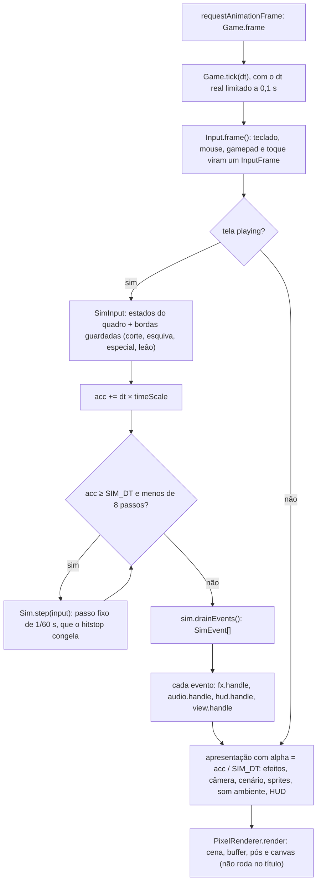
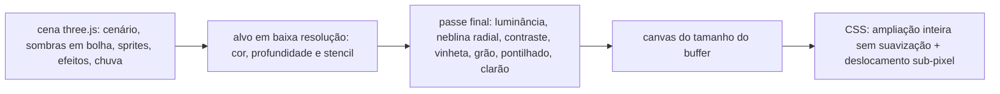
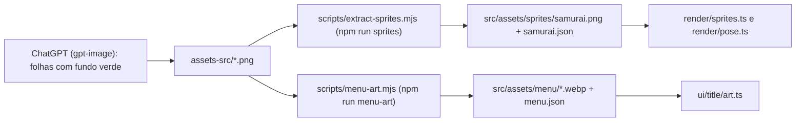

# Arquitetura

Guia para quem quer ler o código ou contribuir. A direção de arte e as decisões de projeto estão no
[briefing técnico e de arte](brief.md); aqui está como as peças se encaixam. Os números citados são os do
código na versão 1.0.0.

## Visão geral

O jogo é uma página só (Vite 8, TypeScript 7 estrito, three.js r186 sobre WebGL2). No centro está a
**simulação** ([src/sim](../src/sim)): determinística, sem three.js, sem DOM e sem `Math.random`, ela avança em
passos fixos de 1/60 s e relata o que aconteceu numa fila de eventos (`SimEvent`). O resto é apresentação:
[src/game.ts](../src/game.ts) lê a entrada, roda os passos e entrega os eventos aos efeitos, ao áudio, ao HUD e
aos sprites. A cena é desenhada num buffer de baixa resolução (1 px = 1/32 m), convertida para tons de cinza no
pós-processamento e ampliada em escala inteira, sem suavização. O áudio é sintetizado (Web Audio, sem arquivos
de som), e cenários, texturas, HUD e o símbolo do título são gerados por código. Só os personagens e a arte do
título vêm de folhas desenhadas (ver [Pipeline de assets](#pipeline-de-assets)).

Tamanho: 41 arquivos TypeScript em `src/` (11.316 linhas) e 1.143 linhas de CSS; 3.582 linhas de testes, com
182 testes de unidade e 20 de ponta a ponta.

## Mapa de pastas

| Pasta | Responsabilidade | Arquivos principais |
|---|---|---|
| `src/` (raiz) | partida do app, orquestração e ajustes de jogo | [main.ts](../src/main.ts) (boot e parâmetros da URL), [game.ts](../src/game.ts) (laço e telas), [config.ts](../src/config.ts) (todas as constantes), [style.css](../src/style.css) (paleta) |
| `src/sim/` | regras do jogo, determinísticas | [sim.ts](../src/sim/sim.ts) (`Sim`), [types.ts](../src/sim/types.ts) (`SimInput`, `Player`, `Enemy`, `SimEvent`) |
| `src/core/` | matemática pura | [math.ts](../src/core/math.ts) (`Vec2` no chão, `Rng` mulberry32) |
| `src/input/` | teclado, mouse, gamepad e toque → `InputFrame` | [input.ts](../src/input/input.ts) |
| `src/render/` | câmera, buffer de baixa resolução, pós-processamento, sprites e poses | [renderer.ts](../src/render/renderer.ts), [camera.ts](../src/render/camera.ts), [sprites.ts](../src/render/sprites.ts), [view.ts](../src/render/view.ts), [pose.ts](../src/render/pose.ts), [occlusion.ts](../src/render/occlusion.ts) |
| `src/fx/` | efeitos de combate: cortes, avisos, tinta, partículas, tremor e clarão | [effects.ts](../src/fx/effects.ts), [arcs.ts](../src/fx/arcs.ts), [decals.ts](../src/fx/decals.ts), [particles.ts](../src/fx/particles.ts), [lines.ts](../src/fx/lines.ts), [common.ts](../src/fx/common.ts) |
| `src/world/` | cenários procedurais, luz, chuva e relâmpagos | [environment.ts](../src/world/environment.ts), [field.ts](../src/world/field.ts), [temple.ts](../src/world/temple.ts), [temple-layout.ts](../src/world/temple-layout.ts), [temple-ground.ts](../src/world/temple-ground.ts), [kit.ts](../src/world/kit.ts), [textures.ts](../src/world/textures.ts), [noise.ts](../src/world/noise.ts), [stages.ts](../src/world/stages.ts) |
| `src/audio/` | som procedural (Web Audio) | [audio.ts](../src/audio/audio.ts), [engine.ts](../src/audio/engine.ts), [director.ts](../src/audio/director.ts), [sfx.ts](../src/audio/sfx.ts), [voice.ts](../src/audio/voice.ts), [debug.ts](../src/audio/debug.ts) |
| `src/ui/` | telas e HUD em DOM sobre o canvas | [hud.ts](../src/ui/hud.ts), [touch.ts](../src/ui/touch.ts), [stone/](../src/ui/stone), [title/](../src/ui/title) |
| `src/assets/` | saídas dos scripts de arte (o jogo as importa; ficam no git) | `sprites/samurai.png` + `.json`, `menu/*.webp` + `menu.json` |
| `assets-src/` | folhas-fonte em PNG, com fundo verde | 14 folhas; `preview/` e `*.v1.*` ficam fora do git |
| `public/` | copiado como está para o build: ícones e imagem de compartilhamento | `favicon.svg`, `apple-touch-icon.png`, `og-image.png` (gerados por `npm run brand`) |
| `scripts/` | ferramentas Node: arte, marca e capturas | [extract-sprites.mjs](../scripts/extract-sprites.mjs), [menu-art.mjs](../scripts/menu-art.mjs), [brand.mjs](../scripts/brand.mjs), [media.mjs](../scripts/media.mjs), [shot.mjs](../scripts/shot.mjs), [anim-strip.mjs](../scripts/anim-strip.mjs) |
| `tests/` | unidade (Vitest) e ponta a ponta (Playwright) | [tests/unit](../tests/unit), [tests/e2e/game.spec.ts](../tests/e2e/game.spec.ts) |
| `docs/` | documentação e imagens do README | [brief.md](brief.md), este arquivo, `media/` (símbolo, faixa e capturas) |

## Comandos

Node 22.12 ou mais novo (o [.nvmrc](../.nvmrc) pede o 24).

| Comando | O que faz |
|---|---|
| `npm run dev` | servidor de desenvolvimento em `localhost:5173` |
| `npm run build` | `tsc --noEmit` + `vite build` → `dist/`, com caminhos relativos (`base: './'`), que funcionam numa subpasta como a do GitHub Pages |
| `npm run build:single` | um `dist-single/index.html` só, com JS, CSS e atlas embutidos ([vite.config.ts](../vite.config.ts)); as fontes ainda vêm do Google Fonts |
| `npm run preview` | serve o build em `localhost:4173` |
| `npm run typecheck` · `npm test` · `npm run test:e2e` | tipos, unidade e ponta a ponta |
| `npm run check:repo` | links locais, identidade, lockfile e arquivos destinados ao Git |
| `npm run check` | auditoria, tipos, unidade, builds normal e de arquivo único, ponta a ponta |
| `npm run sprites` · `npm run menu-art` | regeram o atlas dos personagens e a arte do título a partir de `assets-src/` |
| `npm run brand` · `npm run media` | marca (símbolo, ícones, faixa e prévia de link) e capturas do README |

## O quadro de jogo

`Game.frame` roda a cada `requestAnimationFrame` e chama `Game.tick(dt)`, o mesmo método que os testes e os
scripts de captura chamam para avançar o tempo com o laço congelado.

- **Passo fixo com acumulador.** Enquanto `acc ≥ SIM_DT` (1/60 s), roda um `Sim.step`, no máximo 8 por quadro;
  se bater o limite, o acumulador zera e o jogo fica mais lento em vez de entrar em espiral.
- **Entrada lida por quadro, entregue por passo.** Movimento, mira, defesa e carga do iaido são estados e valem
  para todos os passos do quadro. Corte, esquiva, especial e leão são bordas: ficam em `pending*` até o primeiro
  passo (num quadro sem passo, esperam o próximo). Na simulação, cada borda vira um buffer com prazo
  (`PLAYER.attackBuffer` 0,22 s, `dashBuffer` 0,14 s, `LION.buffer` 0,3 s), então um aperto adiantado ainda vale.
- **Hitstop** fica na simulação: cada impacto pede um congelamento (de 0,045 s no corte comum a 0,16 s no Kiai;
  vale o maior), durante o qual `Sim.step` só desconta o tempo e guarda as bordas.
- **Câmera lenta da morte.** `playerDeath` põe `timeScale` em 0,35, que volta a 1 a +0,25 por segundo; 2,4 s
  depois a tela vira `over`.
- **Interpolação.** A simulação guarda `prev` e `pos`; a apresentação desenha em `prev + (pos − prev) × alpha`.
- **Telas** (`Screen` em [hud.ts](../src/ui/hud.ts)): `loading`, `title`, `playing`, `paused` e `over`. Fora de
  `playing` a simulação não anda; em `title` e `paused` as animações também param, e no título a cena 3D nem é
  desenhada (a paisagem cobre a tela). Esc, P e Start alternam a pausa; perder o foco da aba pausa.
- **Partida nova.** A semente avança por um gerador congruente (`seed × 1664525 + 1013904223`) e o cenário sai de
  `stageFor(seed)`; a partida montada para o título é aproveitada se ainda não começou.

## Entrada

[input.ts](../src/input/input.ts) junta quatro dispositivos num `InputFrame`, com direções em coordenadas de
**tela** (x para a direita, y para cima); o jogo converte para o chão com `fromScreen`
([pose.ts](../src/render/pose.ts)). A mira do mouse é relativa ao herói projetado na tela (`setAimOrigin`). O
gamepad segue o mapeamento padrão do navegador (zona morta 0,22), e os botões de toque
([touch.ts](../src/ui/touch.ts)) escrevem em `input.virtual`. O último dispositivo usado (`device`) decide as
teclas que o HUD mostra.

| Ação | Teclado | Mouse | Gamepad | Toque |
|---|---|---|---|---|
| Mover | WASD / setas | — | analógico esquerdo / direcional | joystick |
| Mirar | — | cursor | analógico direito | — |
| Corte (combo de 3); no leão, Garra | J | botão esquerdo | X / RB | Corte |
| Defesa (segurar); parry (apertar no instante do golpe) | K / I | botão direito | RT | Defesa |
| Esquiva | Espaço / Shift | — | A / LB | Esquiva |
| Iaido (segurar e soltar); no leão, Rugido | L / E | — | B / LT | Iaido |
| Kiai ou Hanafubuki (Ki cheio) | Q | — | Y | Kiai |
| Forma de leão (só o Ronin) | R | — | R3 | Leão |
| Pausa · som | Esc ou P · M | — | Start · Select | botões no canto |

Nos menus, Enter, Espaço, J, o clique e A/Start confirmam.

## Simulação

**Contrato.** `new Sim(opts)` recebe semente, raio da arena, raio de surgimento, obstáculos, ponto de partida e
se o personagem tem a forma de leão; depois vêm `step(input: SimInput)` e `drainEvents(): SimEvent[]`.
`SimEvent` tem 33 tipos (ondas, golpes, acertos, mortes, defesa e parry, iaido, Kiai, leão e passos), e as
posições nos eventos são cópias. Coordenadas: `Vec2 {x, z}` no chão (y é a altura no three); a arena é um
círculo de 36 m de raio centrado na origem.

**Ordem de um passo** (`Sim.step`): as bordas da entrada vão para os buffers e `prev` recebe `pos`; se há
hitstop, o passo para aí. Senão: `updatePlayer` → `resolvePendingHits` (golpes à espera da tolerância do parry)
→ `assignTokens` → `updateEnemy` de cada inimigo → remoção dos mortos (1,1 s depois de cair) →
`resolveCollisions` (corpos entre si, borda da arena, círculos e retângulos girados) → `updateWaves` → relógio
do combo.

### Jogador

São 17 estados (`PlayerState`): `idle`, `run`, `attack`, `dash`, `dashEnd`, `guard`, `parry`, `charge`, `iaido`,
`kiai`, `hurt` e `dead`, mais `transform`, `revert`, `claw`, `roarCharge` e `roar` da forma de leão. Parado ou
correndo, a prioridade é: leão › especial › esquiva › corte › defesa › carga do iaido › andar.

| Mecânica | Como funciona | Constantes |
|---|---|---|
| Corte | combo de 3 (dano 1, 1 e 2; o terceiro é pesado e alcança 2,85 m). A partir de `cancelAt`, cada golpe emenda em outro, na esquiva ou na defesa. A ajuda de mira vira o golpe para um inimigo a até 3,6 m num cone de 55° | `COMBO`, `PLAYER` |
| Defesa e parry | segurar protege 105° para cada lado à frente (passa 20% do dano, ou 45% no brutamontes), com os pés plantados. Apertar abre 0,26 s de parry, e um golpe que chegou há menos de 0,07 s ainda pode ser aparado. Aparar atordoa o inimigo por 1,3 s, contra-ataca sozinho (dano 3) e dá 12 de Ki | `GUARD`, `PARRY` |
| Esquiva | 15,5 m/s por 0,17 s, invulnerável por 0,26 s, recarga de 0,5 s; da aterrissagem já saem corte e defesa | `DASH` |
| Iaido | com 40 de Ki, segurar carrega por 0,45 s (andando a 18% da velocidade). Soltar com a carga pronta atravessa 7,2 m em linha (1,35 m de largura, dano 6, limitado à arena); soltar antes desiste | `IAIDO` |
| Kiai (Ronin) e Hanafubuki (Tomoe) | a mesma regra (estado `kiai`), com visual, nome e animação próprios. Com 100 de Ki: 0,62 s de concentração invulnerável, e a explosão mata todos a até 4,6 m e empurra e atordoa até 8 m | `KIAI` |
| Ki e vida | Ki: +2 por acerto, +7 × `ki` do inimigo por abate, +12 por parry. Vida 100: levar dano zera o combo; cura 0,5 por abate e até 25 ao limpar uma onda | `KI`, `PLAYER` |
| Forma de leão (só o Ronin) | com a Fúria cheia, R inicia uma transformação de 2,2 s, invulnerável, com uma onda de choque em 1,48 s. O leão dura 14 s e galopa a 7,6 m/s. Tem a Garra (leque de 45° para cada lado, 5 m, dano 3) e o Rugido (carga de 0,6 s; dano 4 em volta até 6 m; recarga de 2,5 s). Defesa, esquiva e Kiai ficam travados | `LION` |

A Fúria enche só como humano: +1,5 por acerto, +4 × `ki` por abate, +10 por parry e +0,6 por ponto de vida
perdido. Os detalhes da forma estão no [briefing](brief.md#forma-de-leão-só-o-ronin).

### Horda

Cada inimigo é uma máquina de estados (`EnemyState`, 9 estados): `spawn` (0,55 s) → `chase` ou `circle` →
`windup` → `strike` → `recover` → `chase`; `stagger`, `parried` e `dying` interrompem a sequência.

- **Fichas de ataque.** Só `WAVES.maxAttackers(n)` inimigos atacam ao mesmo tempo (2 na onda 1, até 5). A cada
  passo, as fichas livres vão para os mais próximos a até 6 m que não estão em recarga; os outros cercam o
  jogador num anel de 3,4 a 4,3 m, girando devagar. Depois do golpe, o inimigo devolve a ficha e espera de 0,8 a
  1,9 s.
- **Golpe legível.** Com ficha e perto, o inimigo prepara o golpe e emite `enemyWindup` (duração, alcance e arco:
  daí sai o aviso no chão). Ele segue o jogador nos primeiros 60% da preparação; a pista branca aparece 0,3 s
  antes do golpe para todos os tipos (`AI.cueLead`), e o golpe acerta entre 0,04 e 0,15 s do `strike`.
- **Poise.** Golpes absorvidos sem interromper preparação ou ataque: ronin 1, brutamontes 3, ágil 0; golpes
  pesados furam.
- **Desvio de obstáculos.** `avoid` sonda 1,6 m à frente, escolhe um lado e o mantém até 0,5 s depois da última
  batida da sonda (`AI.avoidLook`, `AI.avoidHold`).
- **Surgimento.** Grupos de 1 a 3, fora da tela (raio visível + 1,5 m, até 90% da arena), só em pontos a 1 m ou
  mais de qualquer obstáculo; com o jogador na borda, surgem do outro lado.

| Tipo (`ENEMIES`) | Vida | Velocidade | Dano | Preparação | Poise | Pontos |
|---|---|---|---|---|---|---|
| `ronin` | 3 | 3,3 m/s | 12 | 0,5 s | 1 | 100 |
| `brute` (brutamontes) | 8 | 2,55 m/s | 22 | 0,86 s | 3 | 400 |
| `swift` (ágil) | 1 | 4,9 m/s | 9 | 0,38 s | 0 | 150 |

**Ondas** (`WAVES`): a onda n tem `min(8 + 5(n − 1), 72)` inimigos, com no máximo `min(9 + 3n, 40)` vivos.
Brutamontes entram a partir da onda 3 e ágeis a partir da 4; velocidade, preparação e dano escalam com a onda
(até ×1,35, ×0,7 e ×1,6), e os quatro primeiros a surgir são sempre ronins. **Pontos:** o valor do inimigo vezes
o multiplicador do combo (×1 a ×3, +0,25 a cada 10 golpes); o combo zera depois de 2,6 s sem acertar.

### Determinismo

- Toda a aleatoriedade da simulação passa por `this.rng`, um `Rng` (mulberry32, [math.ts](../src/core/math.ts))
  semeado por `SimOptions.seed`. Não há `Math.random` em lugar nenhum de `src/`: cenário, efeitos, áudio e HUD
  também usam geradores semeados. O passo é fixo e a simulação não lê relógio.
- Mesma semente + mesma sequência de `SimInput` → mesmo estado e mesmos eventos, conferido em
  [sim-horde.test.ts](../tests/unit/sim-horde.test.ts). `?seed=N` fixa a semente da primeira partida e, com ela,
  o cenário sorteado.
- Limites: uma pessoa joga em tempo real, então uma partida não se repete sozinha (para um replay, grave os
  `SimInput` de cada passo); e `Math.sin`, `Math.hypot` e afins podem diferir no último bit entre motores
  JavaScript.

Todos os números de jogo ficam em [config.ts](../src/config.ts), em metros, segundos e radianos: `CAMERA`,
`ANIM`, `ARENA`, `PLAYER`, `COMBO`, `DASH`, `IAIDO`, `KI`, `GUARD`, `KIAI`, `LION`, `PARRY`, `ENEMIES`, `AI`,
`WAVES` e `SCORE`.

## Renderização

| Etapa | O que acontece | Onde |
|---|---|---|
| Buffer | `WebGLRenderTarget` com cor, `DepthTexture` e stencil, `NearestFilter` e sem mipmaps. A escala de ampliação é `round(altura da janela / 480)`, no mínimo 1. O buffer cobre a janela mais 1 px de margem de cada lado, com largura e altura pares (em 1920×1080: ×2, buffer de 962×542) | `PixelRenderer.resize` em [renderer.ts](../src/render/renderer.ts) |
| Pós-processamento | um triângulo de tela cheia faz, em ordem: luminância (pesos Rec. 601), neblina radial em volta do jogador (posição reconstruída da profundidade; vai de 50% a 98% do raio visível, cinza 0,74), contraste 1,12, vinheta, escurecimento com vida baixa, grão, quantização em 20 níveis com pontilhado Bayer 4×4, e por fim clarão (golpes e relâmpagos) e negativo | `POST_FRAG` em renderer.ts |
| Ampliação | o canvas tem o tamanho do buffer; o CSS o amplia pela escala inteira com `image-rendering: pixelated` e o desloca pelo resto sub-pixel da câmera | renderer.ts, [style.css](../src/style.css) |

- **Cor:** `ColorManagement.enabled = false`, `outputColorSpace = LinearSRGBColorSpace`, sem tone mapping; a
  neblina é do pós-processamento (`scene.fog` não é usado).
- **Câmera** ([camera.ts](../src/render/camera.ts)): `OrthographicCamera` com yaw de 45° e pitch de 30°
  (isométrico 2:1), a 60 m do foco, com frustum de buffer ÷ 32 metros (1 px = 1/32 m). Segue o jogador com
  amortecimento e se adianta pela velocidade (0,9 m na máxima). O foco é preso à grade de texels nos eixos da
  tela, para o cenário não cintilar, e o resto vira o deslocamento CSS; o tremor vem de `feedback.shake`.
- **Sprites** ([sprites.ts](../src/render/sprites.ts)): um `SpriteBatch` instanciado (até 320 instâncias)
  desenha todos os personagens num draw call, em billboard vertical ancorado no pé e preso à grade de pixels. Por
  instância vão retângulo no atlas, espelhamento, clarão, dissolução em blocos de 2×2, contorno de 1 texel (só o
  herói) e tom (`TONES` em [view.ts](../src/render/view.ts) diferencia ronin, brutamontes e ágil). Texels com
  alfa < 0,5 são descartados, e o que fica abaixo da linha do pé deita no chão em direção à câmera. O atlas tem
  382 quadros num PNG de 2046×790, com paleta de 7 cinzas.
- **Poses** ([pose.ts](../src/render/pose.ts), puro e testado): do estado da simulação saem quadro e
  espelhamento. A locomoção em 8 direções é presa à distância percorrida (`ANIM`), para o pé não patinar; as ações
  são clipes `[quadro, até t]`. Cada personagem tem um `AnimSet` (`RONIN_ANIM`, `TOMOE_ANIM`), o leão tem andar e
  galope por direção, e a horda usa o conjunto do Ronin.
- **Oclusão** ([occlusion.ts](../src/render/occlusion.ts)): construções com `occluder()` gravam 1 no stencil e
  sprites visíveis gravam 0; um segundo passe dos sprites (profundidade `Greater`, stencil = 1) desenha um xadrez
  claro (herói) ou cinza (horda) onde alguém ficou atrás de uma construção.
- **Sombras:** personagens têm sombra em bolha (`InstancedMesh` de até 160 em view.ts; raio 0,5 m, ou 0,7 m no
  leão). A luz do cenário projeta sombra PCF (mapa de 2048 px cobrindo 60 m) só onde o cenário pede, hoje o
  templo, presa à grade do mapa para não "nadar".

**Efeitos** ([src/fx](../src/fx)): [effects.ts](../src/fx/effects.ts) trata todos os tipos de `SimEvent` num
`switch` e desenha em 5 lotes instanciados, ou seja, 5 draw calls: `SlashBatch` (meia-lua do corte) e
`GroundBatch` (aviso do golpe inimigo, anéis e faixas) em [arcs.ts](../src/fx/arcs.ts); `Decals` (tinta no chão,
atlas gerado pixel a pixel) em [decals.ts](../src/fx/decals.ts); `Particles` (pool fixo, física na CPU) em
[particles.ts](../src/fx/particles.ts); e `LineBatch` (riscos de corte) em [lines.ts](../src/fx/lines.ts). Devolve
`feedback {shake, flash, invert}`, que o jogo aplica na câmera e no pós-processamento; `setStyle('kiai' |
'sakura')` troca o especial pelas pétalas do Hanafubuki.

## Mundo

**Contrato.** `createEnvironment(scene, {arenaRadius, seed, stage})` devolve um `Environment` (`stage`,
`colliders`, `boxes`, `start`, `update`, `lightning`, `onLightning`, `dispose`). Cada cenário é um
`StageBuilder`, `(group, {arenaRadius, seed}) => StageContent`: monta chão e construções num grupo e devolve
obstáculos, ponto de partida, se há sombras, a luz e uma animação opcional. O comum fica em
[environment.ts](../src/world/environment.ts):

- **luz:** sol direcional + céu hemisférico (padrão 1,25 / 1,1);
- **chuva:** 950 gotas em `LineSegments` (1 px), numa caixa que acompanha o foco, com vento, e 240 respingos
  instanciados perto do jogador;
- **relâmpagos:** o primeiro entre 14 e 30 s, depois a cada 20 a 45 s, com clarão duplo; `onLightning` dispara o
  trovão do áudio e `lightning` soma ao clarão do pós-processamento;
- **`dispose()`** libera a memória de vídeo (um teste de ponta a ponta troca de cenário várias vezes e confere
  `renderer.info.memory`).

| | Campo de batalha 野 (`field`) | Templo 寺 (`temple`) |
|---|---|---|
| Arquivos | [field.ts](../src/world/field.ts) | [temple.ts](../src/world/temple.ts), [temple-layout.ts](../src/world/temple-layout.ts) (planta), [temple-ground.ts](../src/world/temple-ground.ts) (chão) |
| Chão | lama em textura de 1024×1024 texels (ladrilho de 32 m) presa ao mundo, posterizada | pintado na grade da tela, com 32 × 16 texels por metro: lajes, pedrisco, jardim rastelado |
| Obstáculos | nenhum | 11 retângulos + 31 círculos, iguais para qualquer semente |
| Luz | padrão, sem sombras projetadas | sol 0,7 / céu 1,9, com sombras |
| Início | (0, 0) | ponto livre a 13 m do centro |

Peças procedurais: [kit.ts](../src/world/kit.ts) (caixas, tornos e telhados com cantos levantados, juntados num
mesh por material), [textures.ts](../src/world/textures.ts) (`Paint`, texturas de luminância a 32 texels/m) e
[noise.ts](../src/world/noise.ts) (ruído de valor sem emenda e `grayTexture`, uma `DataTexture` com
`NearestFilter`, sem mipmaps e sem espaço de cor). Cenário novo: um `StageBuilder`, o id em `STAGE_IDS` e
`STAGES` ([stages.ts](../src/world/stages.ts)) e em `BUILDERS` (environment.ts), `occluder()` no que esconde
personagens e obstáculos só como `Circle` e `Box`, que a horda sabe contornar;
[stage-temple.test.ts](../tests/unit/stage-temple.test.ts) serve de modelo de teste.

## Áudio

[audio.ts](../src/audio/audio.ts) é a fachada: `createAudio(): AudioSystem`, com `unlock`, `handle`, `update`,
`thunder`, `setMuted` e `muted`. O `AudioContext` só é criado no primeiro gesto (pointerdown, keydown ou
touchend); antes disso, ou sem Web Audio, tudo é no-op. O mudo fica em `localStorage` (`ronin-game:muted`).

| Módulo | Papel |
|---|---|
| [engine.ts](../src/audio/engine.ts) | o grafo: barramentos `sfx`, `amb` e `music` → abafador (passa-baixa, ligado quando o herói cai) → master → compressor; reverb por convolução; "duck" que abaixa música e ambiente no iaido, no parry, no Kiai e nos golpes do leão; camas contínuas de chuva, vento e drone; limite de vozes por categoria |
| [director.ts](../src/audio/director.ts) | traduz `SimEvent` e estado em sons: panorâmica pela posição na tela, atenuação pela distância ao herói, taiko da onda agendado 0,25 s adiante (intensidade máxima com 12 inimigos vivos) e coração abaixo de 30% de vida. Lê só uma fatia da simulação (`SimLike`), para soar igual ao vivo e num `OfflineAudioContext` |
| [sfx.ts](../src/audio/sfx.ts) | os 29 sons sintetizados (corte, impacto, metal, passo, trovão, taiko, rugido…), com `SFX_LEVEL` (a mesa de mixagem) e `SFX_LEN` (a duração usada nas medições) |
| [voice.ts](../src/audio/voice.ts) | `Voice` agrupa os nós de um som e desconecta tudo ao terminar; o `kit` de cada contexto guarda ruídos branco, rosa e marrom em laço e a resposta ao impulso do reverb; a variação usa `Rng` semeado |
| [debug.ts](../src/audio/debug.ts) | mede pico e RMS (dBFS) de um som ou da mistura num `OfflineAudioContext`; carregado sob demanda pelos ganchos `window.__game.audio.debugRender`, `debugRenderAll`, `debugMix` e `debugState` |

## Interface

| Módulo | Papel |
|---|---|
| [hud.ts](../src/ui/hud.ts) | DOM sobre o canvas: título, pausa, fim de jogo, placar, onda, combo e textos flutuantes (de um pool fixo). `createHud(root, callbacks, input)`: `handle(ev)` reage aos eventos; `input(frame)` cuida da escolha no título e avisa quando a ação apertada está indisponível. Só toca o DOM quando um valor muda e marca a tela em `document.body.dataset.screen` |
| [stone/](../src/ui/stone) | HUD de pedra e tinta: [view.ts](../src/ui/stone/view.ts) calcula o que aparece (puro, um objeto reaproveitado a cada quadro, testado); [stone-hud.ts](../src/ui/stone/stone-hud.ts) escreve no DOM só o que mudou; [art.ts](../src/ui/stone/art.ts) gera lajes, rachaduras, grão e giz em SVG (determinístico); [icons.ts](../src/ui/stone/icons.ts) tem os 12 ícones de giz |
| [title/](../src/ui/title) | [art.ts](../src/ui/title/art.ts): URLs e pré-carga da arte do título e `emblemSvg()`, o símbolo do jogo, um ensō de pincel com 雨 no meio (contorno do glifo da fonte Yuji Boku, SIL OFL 1.1); [title.css](../src/ui/title/title.css): layout em `cqw`/`cqh` |
| [touch.ts](../src/ui/touch.ts) | joystick flutuante na metade esquerda e botões à direita: Corte, Defesa, Esquiva, Iaido, Kiai e, só para o Ronin, Leão (no leão, Garra e Rugido). Aparece com `pointer: coarse` ou no primeiro toque e escreve em `input.virtual` |

**Acessibilidade** (o que existe hoje): uma região `role="status"` com `aria-live="polite"` anuncia ondas, Fúria,
troca de forma e fim de jogo; pausa e fim de jogo são `role="dialog"` com `aria-modal`; a escolha de personagem
é um `radiogroup` que a tecla Tab alcança (há teste de ponta a ponta); a tabela de controles fica em abas
(teclado e mouse, gamepad, toque); os botões de som usam `aria-pressed`; há estilos de `:focus-visible`;
`prefers-reduced-motion` reduz as animações da interface; e o símbolo tem texto alternativo ("Ensō com o kanji
雨 (chuva)").

A paleta está em [style.css](../src/style.css): `--ink` #0b0b0c, `--paper` #e9e7e2, `--mist` #bcbcbc e `--ash`
#6d6c6a. As fontes são Shippori Mincho B1 (600/800, títulos) e DotGothic16 (interface), do Google Fonts, pedidas
em [index.html](../index.html). Persistência: `ronin-game:best` (pontos e onda) e `ronin-game:muted`, sempre
dentro de try/catch.

## Pipeline de assets

**Procedência.** As 14 folhas de `assets-src/` foram geradas com o ChatGPT (gpt-image); cada PNG traz um
manifesto C2PA (`softwareAgent` "ChatGPT", gerador "OpenAI Media Service API"). O resto da parte visual é
código: o ensō sai de `emblemSvg()`, o 雨 é o contorno do glifo da Yuji Boku, e cenários, texturas e HUD são
procedurais.

| Folhas-fonte | Viram | Script |
|---|---|---|
| `movement.png`, `movement2.png`, `combat.png`, `special.png` (Ronin) | quadros do atlas | extract-sprites |
| `tomoe-movement.png`, `tomoe-combat.png`, `tomoe-special.png` | quadros do atlas | extract-sprites |
| `lion-transform.png`, `lion-movement.png`, `lion-claw.png`, `lion-roar.png` | quadros do atlas, na escala do leão | extract-sprites |
| `menu-landscape.png` · `menu-samurai.png` | `landscape.webp` · `ronin.webp` e `tomoe.webp` | menu-art |
| `reference.png` | referência original do personagem (nenhum script a lê) | — |

**[extract-sprites.mjs](../scripts/extract-sprites.mjs)**, folha por folha:

1. chroma key com alfa suave: o fundo é a mediana dos quatro cantos, o pixel em que o verde domina vermelho e
   azul fica transparente, e o cinza é "desmisturado" do fundo;
2. componentes conexos: uma pose por componente grande, com os efeitos brancos soltos indo para a pose mais
   próxima; quadros encostados se separam por costura de custo mínimo ou por crescimento a partir do tronco
   (`autoCuts`);
3. tom de cinza normalizado entre as folhas e escala por linha: os quadros `ref` são medidos e levados à altura
   `h` (`STAND` = 64 texels, 2 m de samurai de pé; o leão usa `LION_H` = 56, com fator por bloco ou por quadro);
4. redução por supersampling 5×5 numa grade alinhada ao pé e ao tronco, para as poses não tremerem;
5. alfa binário e paleta comum de 7 cinzas por k-means (as folhas do leão, com `palette: false`, ficam fora do
   cálculo); quadros derivados (`DERIVED`: a passagem da corrida da Tomoe);
6. empacotamento em prateleiras (até 2048 px de largura) → `samurai.png` + `samurai.json` (`x, y, w, h` e a
   âncora `ax, ay` no pé), mais a prévia `assets-src/preview/atlas-frames.png`.

**Para acrescentar uma folha ou um quadro:** desenhe em PNG, com fundo verde chapado e personagens em tons de
cinza, uma linha de poses por vez. Acrescente uma entrada em `SHEETS` com `file` e `rows`: os `names` na ordem
de leitura (nome começado com `_` entra na separação e fica fora do atlas), `ref` (índices medidos) e `h`
(altura alvo), ou `factorFrom` para herdar o fator de outra linha; se os bonecos se encostam, `autoCuts`
(`rowsY`, `minW`, `maxW`, `seams`). Rode `npm run sprites` e confira a prévia (`LION_DUMP=1` mostra a escala do
leão). `FrameName` é `keyof` do JSON, então o nome novo já tem tipo em [pose.ts](../src/render/pose.ts), onde
entra num `Cycle` ou `Clip` do `AnimSet`. Confira a animação com `node scripts/anim-strip.mjs --manual` e
versione `samurai.png` e `samurai.json` juntos (o atlas inteiro é refeito).

**[menu-art.mjs](../scripts/menu-art.mjs)** converte a paisagem em `landscape.webp` (qualidade 0,82) e recorta do
verde `ronin.webp` e `tomoe.webp` (0,9): os dois maiores componentes são os personagens, os fiapos vão para o mais
próximo e os dois saem com a mesma faixa vertical, na mesma escala; `menu.json` guarda as medidas. O WebP é
codificado pelo Chromium do Playwright (`canvas.toDataURL`), sem dependência nova; `--preview` grava conferências.

**[brand.mjs](../scripts/brand.mjs)** gera a marca a partir do próprio código (carrega `emblemSvg()` pelo Vite e
lê as cores de `style.css`): `docs/media/emblem-ink.svg` e `emblem-paper.svg` (o símbolo para temas claro e
escuro), `docs/media/banner.png`, `public/favicon.svg`, `public/apple-touch-icon.png` (180×180) e
`public/og-image.png` (1280×640), com os PNG em cinza puro. **[media.mjs](../scripts/media.mjs)** grava as
capturas e o `gameplay.gif` do README em `docs/media/`, contra o jogo rodando (`--url`, padrão `localhost:5173`),
com o laço congelado andando 1/60 s por vez e semente, cenário e personagem fixos. [shot.mjs](../scripts/shot.mjs)
(uma captura, com roteiro de teclas) e [anim-strip.mjs](../scripts/anim-strip.mjs) (tira de quadros em volta do
herói) são ferramentas de revisão visual.

## Testes

| | Unidade | Ponta a ponta |
|---|---|---|
| Ferramenta | Vitest 5, ambiente node ([vitest.config.ts](../vitest.config.ts)) | Playwright 1.63, Chromium com SwiftShader (WebGL por software) ([playwright.config.ts](../playwright.config.ts)) |
| Onde | [tests/unit](../tests/unit), 12 arquivos | [tests/e2e/game.spec.ts](../tests/e2e/game.spec.ts) |
| Quantos | 182 testes, que rodam em poucos segundos | 20 testes, em série (1 worker) |
| Servidor | nenhum | servidor de desenvolvimento na porta 5190; com `E2E_PROD=1`, `vite build` + `vite preview` na 4173 |

Os testes de unidade não usam WebGL: cobrem a simulação e os modelos puros (poses, HUD de pedra, matemática); o
do templo monta a geometria com three.js em node para conferir a planta.

| Arquivo | Testes | Cobre |
|---|---|---|
| [sim-lion.test.ts](../tests/unit/sim-lion.test.ts) | 31 | Fúria, transformação, forma de leão, garra e rugido |
| [sim-player.test.ts](../tests/unit/sim-player.test.ts) | 27 | movimento, corte, ajuda de mira, esquiva e iaido |
| [sim-horde.test.ts](../tests/unit/sim-horde.test.ts) | 27 | ataque inimigo, limite de atacantes, ondas, surgimento, colisões, determinismo, morte e pontuação |
| [pose.test.ts](../tests/unit/pose.test.ts) | 19 | tela ↔ mundo, 8 direções, quadros, poses do jogador e da horda |
| [math.test.ts](../tests/unit/math.test.ts) | 16 | ângulos, distância a segmento e `Rng` |
| [sim-guard.test.ts](../tests/unit/sim-guard.test.ts) | 15 | defesa, parry e aterrissagem da esquiva |
| [pose-lion.test.ts](../tests/unit/pose-lion.test.ts) | 15 | quadros, clipes e poses do leão |
| [stone-view.test.ts](../tests/unit/stone-view.test.ts) | 10 | barras e comandos do HUD de pedra (inclusive sem alocar a cada quadro) |
| [sim-obstacles.test.ts](../tests/unit/sim-obstacles.test.ts) | 7 | contorno de construções e surgimento fora delas |
| [bot.test.ts](../tests/unit/bot.test.ts) | 6 | balanceamento com o robô e desempenho |
| [sim-kiai.test.ts](../tests/unit/sim-kiai.test.ts) | 5 | Kiai |
| [stage-temple.test.ts](../tests/unit/stage-temple.test.ts) | 4 | planta do templo: início livre e horda que alcança o jogador |

**O robô** ([tests/unit/bot.ts](../tests/unit/bot.ts)) é um jogador automático que não faz parte do jogo: anda
até o inimigo mais próximo que não está preparando golpe, corta a até 2 m, esquiva quando um golpe perto está
para sair e usa o iaido com 3 ou mais inimigos alinhados. Perfis: `DEFAULT_BOT` (reação instantânea),
`HUMAN_BOT` (0,25 s de reação, percebe 70% das preparações) e `MASHER_BOT` (só corta). `bot.test.ts` garante que
o jogo não é impossível (o robô passa da onda 1 na maioria das sementes) nem trivial (quem fica parado morre
antes da onda 3), imprime tabelas de calibragem e exige que 60 s de simulação com 40 inimigos rodem em menos de
1,5 s.

**Ponta a ponta** (20): título (5: começar, personagens imóveis, escolha por clique e setas, Tab, layout em 14
tamanhos de tela de 320×568 a 2560×1080); cenário (3: sorteio pela semente e `?stage`, memória de vídeo, 15 s de
luta no templo sem atravessar construções); personagens (3: leão do Ronin, Tomoe sem leão, especial da Tomoe);
mecânicas (5: WASD, corte, iaido, parry, Kiai); fluxo (2: pausa, morte e "Lutar de novo"); layout de celular (1);
estabilidade com 25 s de entradas aleatórias (1). Os testes de mecânica abrem com
`?autostart&seed=3&stage=field`, e 16 dos 20 falham com qualquer erro de página ou de console (menos os das
fontes externas sem rede).

**Ganchos de teste** (fazem parte do contrato):

| Gancho | Para quê |
|---|---|
| `window.__game` | a instância de `Game`: `screen`, `sim` (o estado inteiro, `spawnEnemy`, `startWave`, `waveTimer`…), `fps`, `tick(dt)`, `renderer`, `audio`, `stage`, `setStage` |
| `?autostart` | começa a partida sem o título (e sem pré-carregar a arte dele) |
| `?seed=N` | fixa a semente e, com ela, o cenário sorteado |
| `?char=ronin\|tomoe` | abre o título com o personagem já escolhido |
| `?stage=field\|temple` | fixa o cenário em todas as partidas |
| `document.body.dataset.screen` | `loading`, `title`, `playing`, `paused` ou `over` |
| `button[data-action]` | `start`, `resume`, `restart`, `mute` e `pause` |

Para avançar quadro a quadro, congele o laço (`window.requestAnimationFrame = () => 0`) e chame
`__game.tick(1 / 60)`, como fazem `anim-strip.mjs --manual` e `media.mjs`; com SwiftShader, o WebGL é lento.

## Regras para contribuir sem quebrar

1. **Só cinza.** Materiais com hex cinza (`0x8a8a8a`) e CSS na paleta. O pós-processamento converte a cena para
   luminância, mas o HUD em DOM não passa por ele: ali a regra é sua. Branco puro é para golpes, brilhos e avisos.
2. **Pixel art.** `NearestFilter`, sem mipmaps, sem `colorSpace` sRGB nas texturas, sem tone mapping e sem
   `scene.fog`; detalhe na escala de 32 texels por metro (a dos sprites); ampliação só inteira e nunca suavizada,
   nem no CSS.
3. **Determinismo.** Nada de `Math.random`, `Date.now` ou `performance.now` em `src/sim`: a aleatoriedade vem de
   `this.rng`. A simulação não importa three.js nem DOM (os testes de unidade rodam em node).
4. **A simulação fala por eventos.** Um acontecimento novo vira um tipo novo em `SimEvent`, com posições
   copiadas, e um `case` em cada consumidor que se importa com ele.
5. **Sem alocação por quadro nos laços quentes da apresentação:** pools fixos e lotes instanciados (efeitos em 5
   draw calls; sprites em 1, mais o passe de oclusão), objetos reaproveitados (como o `StoneView`) e DOM tocado
   só quando o valor muda. A simulação ainda cria vetores pequenos a cada passo (`core/math.ts` devolve objetos
   novos); o teste de desempenho do robô é a rede de segurança.
6. **Balanceamento** só em [config.ts](../src/config.ts); depois de mudar, rode `npm test` e leia a tabela do robô.
7. **Arte.** Mudou `assets-src/` ou um script de arte? Regere (`npm run sprites`, `npm run menu-art`) e versione
   as saídas em `src/assets/`. Prévias (`assets-src/preview/`) e versões antigas (`*.v1.*`, `*.bak`) ficam fora do
   git.
8. **Antes do pull request**, rode `npm run check`. O TypeScript é estrito, com `noUnusedLocals` e
   `noUnusedParameters`; comentários em português do Brasil, curtos, no estilo dos arquivos vizinhos.
9. **Contratos.** Não mude as assinaturas exportadas sem combinar:

| Módulo | Exporta |
|---|---|
| `src/sim/*` | `Sim` (`step`, `drainEvents`), `SimInput`, `SimEvent` e os tipos de estado |
| `src/render/*` | `IsoCamera`, `PixelRenderer`, `SpriteBatch`, `View` e as poses (`AnimSet`, `playerPose`, `enemyPose`) |
| `src/world/environment.ts` | `createEnvironment(scene, {arenaRadius, seed, stage}): Environment` e `StageBuilder` |
| `src/fx/effects.ts` | `createEffects(scene): Effects` (`handle`, `update`, `feedback`, `setStyle`, `clear`) |
| `src/audio/audio.ts` | `createAudio(): AudioSystem` (`unlock`, `handle`, `update`, `thunder`, `setMuted`, `muted`) |
| `src/ui/hud.ts` | `createHud(root, callbacks, input): Hud` (`setScreen`, `update`, `input`, `handle`, `setMuted`, `setProjector`, `setCharacter`) |
