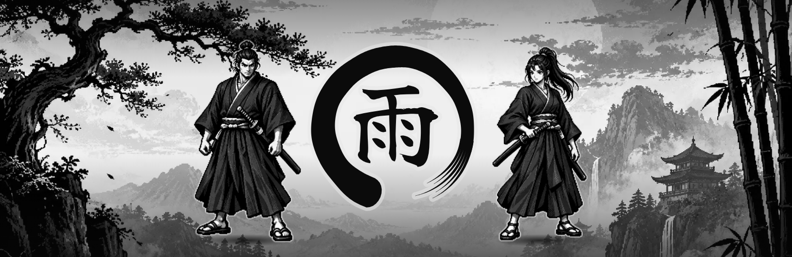

# Identidade visual

<p align="center"></p>

O jogo tem apenas um símbolo: o ensō de nanquim com 雨 no centro. `ronin-game` é o identificador técnico
do pacote e do repositório; Ronin é um dos personagens. Não há um título por extenso nem um logotipo tipográfico.
Em campos que exigem texto, use **雨**. Para leitores de tela, descreva: **Ensō com o kanji 雨 (chuva)**.

## Elementos

| Elemento | Aplicação |
|---|---|
| Ensō e 雨 | Identificação principal; preserve a proporção e a abertura do círculo |
| Nanquim e papel | Contraste de superfícies, bordas irregulares e pinceladas |
| Paisagem e samurais | Banner, tela inicial e imagem de compartilhamento |
| Pixel art | Cena e sprites ampliados sem suavização |
| DotGothic16 / Shippori Mincho B1 | Interface e títulos, respectivamente |

A paleta vem de [`src/style.css`](../src/style.css): nanquim `#0b0b0c` e papel `#e9e7e2`, com cinzas
intermediários. As peças PNG de divulgação são convertidas para cinza neutro. No combate, o branco destaca
golpes e avisos. Evite acrescentar cores de destaque ou texto sobre o símbolo.

## Arquivos prontos

| Arquivo | Uso |
|---|---|
| [emblem-ink.svg](media/emblem-ink.svg) | Símbolo sobre fundo claro |
| [emblem-paper.svg](media/emblem-paper.svg) | Símbolo sobre fundo escuro |
| [banner.png](media/banner.png) | Topo do README, 1600 × 520 |
| [og-image.png](../public/og-image.png) | Compartilhamento e social preview do GitHub, 1280 × 640 |
| [favicon.svg](../public/favicon.svg) | Abas do navegador |
| [apple-touch-icon.png](../public/apple-touch-icon.png) | Atalho em dispositivos móveis, 180 × 180 |

O desenho original está em [`src/ui/title/art.ts`](../src/ui/title/art.ts). Não redesenhe as cópias manualmente:

```bash
npx playwright install chromium
npm run brand
npm run brand -- --preview
```

O segundo comando de marca acrescenta amostras em `assets-src/preview/`, ignoradas pelo Git.
As capturas do README são geradas com `npm run media`; veja o [guia de contribuição](../CONTRIBUTING.md).
Os créditos da fonte usada no símbolo estão em [THIRD_PARTY_NOTICES.md](../THIRD_PARTY_NOTICES.md).
